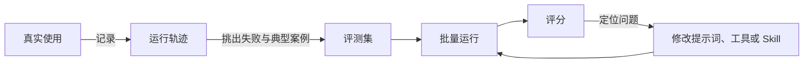

> **当前演示**：自动化测试覆盖模拟建议的生成规则；运行轨迹与模型评测为设计方案。

Agent 的输出并不固定，改一句提示词、换一个模型，效果都可能变好或变差。评估用来回答：这次改动有没有让 Agent 变得更好。

## 怎么设计

| 评分方式 | 适合检查 | 例子 |
| --- | --- | --- |
| 代码检查 | 有明确规则的结果 | 修改能否通过校验、元素是否重叠、是否误删用户内容 |
| 模型评分 | 开放式的质量 | 建议是否贴合画板主题、几个方向之间是否真正不同 |
| 人工复核 | 校准前两种评分 | 每次较大改动后抽查轨迹 |

1. **每次运行都留下轨迹**：记录上下文各部分的 token 数、模型输出、工具调用与结果、权限决定，以及用户最终的选择（采纳、调整、撤销）。
2. **关注用户的实际反应**：统计建议的采纳率、采纳后又被修改或撤销的比例、中途停止生成的比例。
3. **评测集来自真实失败**：从 20–50 个任务开始，每个任务包括示例画板、请求和评分标准，优先收录出过错的情况。
4. **三种评分组合使用**：能用代码判断的不用模型；模型评分的标准要和人工评分对齐，并允许给出「无法判断」。
5. **看稳定性，而不只看最好的一次**：每个任务运行多次，关注每次都成功的比例。
6. **定期阅读轨迹**：确认失败确实是 Agent 的问题，而不是任务描述或评分标准有误。

## 为什么这样设计

### 1. 每次运行都留下轨迹

Agent 出错时，只看最终结果很难判断原因：是没读到关键元素、选错了工具，还是工具返回了错误信息。轨迹记录完整过程，问题可以定位到具体一步。OpenAI Agents SDK 默认记录每次运行的轨迹，原因相同。在 Muse 中，轨迹默认只保存在本机，导出需要用户同意。

### 2. 关注用户的实际反应

创作建议没有唯一的正确答案，用户的选择是最直接的反馈。采纳后很快撤销，比直接忽略更能说明这条建议有问题。

### 3. 评测集来自真实失败

Anthropic 在《Demystifying evals for AI agents》中建议，从 20–50 个来自真实失败的简单任务开始就足够有用。数量不多但具有代表性的评测集，比大量凭空编写的用例更能反映真实问题。

### 4. 三种评分组合使用

代码检查快、结果确定，适合检查规则；模型评分适合判断开放式的质量，但结果不稳定，需要和人工评分校准。允许回答「无法判断」，可以减少模型硬给分数的情况。

### 5. 看稳定性，而不只看最好的一次

如果每次成功的概率是 75%，连续三次都成功的概率只有约 42%。用户每次使用都会遇到其中一次结果，面向用户的 Agent 更需要每次都可靠，而不只是偶尔做得好。

### 6. 定期阅读轨迹

评分标准本身也可能出错。Anthropic 举过一个例子：CORE-Bench 中，过于死板的评分把「96.12」判为错误，因为标准答案是「96.124991…」；修正评分问题并放宽运行环境的限制后，模型得分从 42% 升到 95%。不读轨迹，就分辨不出是 Agent 能力不足，还是评分写错了。

## 参考

- [Demystifying evals for AI agents](https://www.anthropic.com/engineering/demystifying-evals-for-ai-agents)（Anthropic）
- [Writing effective tools for agents — with agents](https://www.anthropic.com/engineering/writing-tools-for-agents)（Anthropic）
- [Tracing](https://openai.github.io/openai-agents-python/tracing/)（OpenAI Agents SDK）
