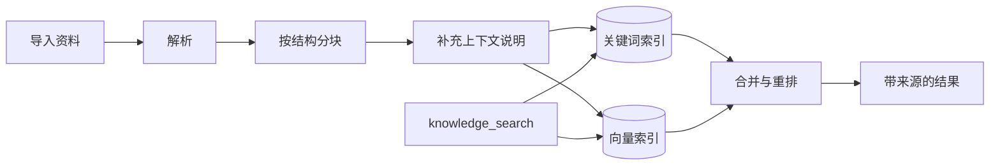

> **当前演示**：只读取当前画板的文字；导入资料、建立索引和检索为设计方案。

知识库是画板之外、由用户提供的参考资料：其他画板、导入的文档和图片、收藏的网页。Agent 通过检索工具查找资料，并在建议中标明来源。

## 怎么设计

| 资料 | 检索方式 |
| --- | --- |
| 当前画板 | `canvas_search` 直接查询画板数据 |
| 其他画板 | 先看标题和摘要列表，再按需读取 |
| 导入的文档、网页 | 关键词与向量混合检索，结果再重排 |
| 图片 | 标题、说明和识别出的文字参与检索 |

导入资料的处理流程：

1. **按资料特点选择检索方式**：画板内容直接查询，导入资料建立索引。
2. **入库保留结构和位置**：按标题和段落分块，每块记录所属文件和页码或段落；分块前补充一句说明，写明这块内容来自哪份资料、讲的是什么。
3. **混合检索加重排**：关键词检索匹配专有名词和色号，向量检索匹配意思相近的表达，合并后重排，取最相关的几条。
4. **检索由 Agent 决定**：检索是工具，不是每次请求前的固定步骤；模型决定是否检索、用什么词，可以换个说法再查；结果先返回摘要和来源编号，需要时再用 `knowledge_read` 阅读原文。
5. **建议标明来源**：引用了资料的便签附带来源，点击可打开原文位置；没有资料支持的内容注明是 Agent 的想法。
6. **本地优先，资料视为不可信内容**：原文和索引默认保存在本机浏览器；资料只作为数据使用，其中的指令不会被执行。

## 为什么这样设计

### 1. 按资料特点选择检索方式

画板每次编辑都会让索引过期，而画板内容不多，直接查询结构化数据既实时又准确。代码类 Agent 不再为代码库建立向量索引，也主要出于同样的原因：内容变化太快。

导入的资料量大、内容稳定，适合建立索引。LlamaIndex 2026 年的对比测试中，资料规模较大时，索引检索比让 Agent 逐个翻文件更快，准确率也略高。没有一种方法适合所有资料，按资料特点选择更合适。

### 2. 入库保留结构和位置

单独切出来的一段话常常缺少上下文，例如「主色调改为雾蓝」，单看这一句不知道说的是哪个项目。Anthropic 的 Contextual Retrieval 实验中，为每块内容补充上下文说明后，检索失败率下降 49%，加上重排后下降 67%。

记录页码和段落位置，引用才能定位到原文。

### 3. 混合检索加重排

关键词检索擅长精确匹配，例如品牌名、色号 `#DCE4E7`；向量检索擅长匹配近义表达，例如「安静的感觉」和「大量留白」。两者互补，再由重排模型从候选中挑出最相关的几条。这是目前知识库检索的常用组合。

### 4. 检索由 Agent 决定

固定在每次请求前检索，会拿原始问题去查，而「再延伸三个方向」这类请求通常不需要资料，检索结果只会带来干扰。由 Agent 决定，它可以在需要时检索，也可以根据第一次的结果调整关键词。先看摘要再读原文，也能节省上下文。

### 5. 建议标明来源

用户可以核对灵感来自哪份资料，也能分清哪些是资料中的内容、哪些是 Agent 的想法。来源由运行框架根据检索结果生成，不由模型填写，避免出现编造的出处。

### 6. 本地优先，资料视为不可信内容

用户导入的往往是未发布的作品和内部资料，默认留在本机符合 Muse 本地优先的原则。向量可以在浏览器内用小型模型计算，也可以由用户选择的服务计算。

导入的文档和网页是间接提示词注入的主要来源，例如网页里藏着一句「忽略之前的要求」。资料内容只能作为数据参考，具体防护见「权限与安全」。

## 参考

- [Contextual Retrieval](https://www.anthropic.com/news/contextual-retrieval)（Anthropic）
- [Did Filesystem Tools Kill Vector Search?](https://www.llamaindex.ai/blog/did-filesystem-tools-kill-vector-search)（LlamaIndex）
- [Effective context engineering for AI agents](https://www.anthropic.com/engineering/effective-context-engineering-for-ai-agents)（Anthropic）
