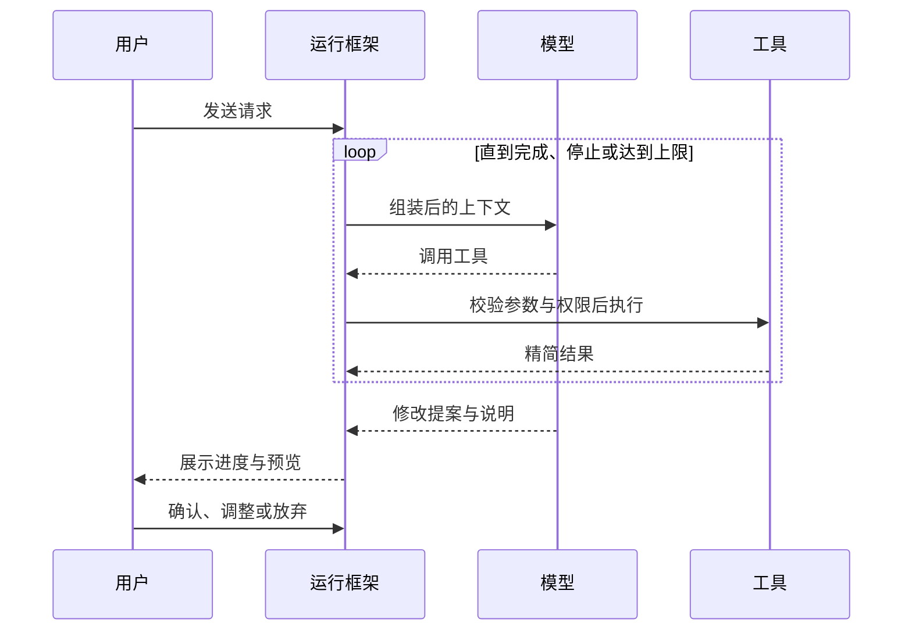

> **当前演示**：一次请求只运行一次本地规则，没有工具循环；停止生成、恢复草稿已按本章设计实现。

一次请求就是一轮循环：模型读取上下文，决定调用工具还是给出结果；运行框架执行工具并把结果放回上下文，直到任务完成、用户停止或达到上限。

## 怎么设计

以「根据当前画板，延伸三个创意方向」为例：

1. **单一主循环**：一个模型在一轮对话中完成理解、读取和提出修改；循环有步数和 token 上限，到达上限时汇报进展，不静默失败。
2. **先列计划再执行**：需要三步以上的任务先写出待办清单，显示在对话中，每完成一步更新状态。
3. **子 Agent 只读不写**：资料较多时，例如「从 5 份参考资料中提炼风格关键词」，由子 Agent 在独立上下文中阅读，只返回摘要，不修改画板。
4. **追加式事件记录**：用户消息、工具调用、结果、权限决定和用户确认按顺序写入当前画板的事件记录；界面展示、恢复和评估都读取这份记录。
5. **随时可停，中断不留半成品**：停止会中断模型请求和未完成的工具；未确认的修改不写入画板，刷新后从事件记录恢复对话。

## 为什么这样设计

### 1. 单一主循环

创作任务的步骤之间高度依赖：选哪个方向延伸，取决于前面读到的画板细节。Cognition 在《Don't Build Multi-Agents》中指出，并行的 Agent 看不到彼此的完整过程，各自做出的隐含决定容易冲突；在画板上表现为风格不一致或互相覆盖。

步数上限防止模型陷入反复调用工具的循环。到达上限时总结已完成的部分，用户可以决定是否继续，比无限重试更可控。

### 2. 先列计划再执行

待办清单每次更新都会出现在上下文末尾，相当于让模型重读目标。Manus 把这种做法称为 recitation（复述），用来减少长任务中的目标偏移。

计划在执行前可见，用户发现方向不对可以立即纠正，比等结果出来再返工成本低。

### 3. 子 Agent 只读不写

子 Agent 的价值是上下文隔离：大量原文在子 Agent 里读完，主循环只接收结论，不被细节占满。Anthropic 的多 Agent 研究系统采用的也是「主 Agent 分派、子 Agent 并行检索、结果汇总回主 Agent」的结构。

只读限制让画板始终只有一个写入者，修改总由看过完整上下文的主循环提出。代价是更多 token：Anthropic 报告其多 Agent 系统的用量约为普通对话的 15 倍，所以只在资料多、可以并行阅读时使用。

### 4. 追加式事件记录

Anthropic 在 Managed Agents 中把会话设计为独立于运行框架的追加日志，任一部分失败后都能从日志继续。Muse 的事件记录起同样的作用：模型的上下文窗口只是记录的一个视图，需要压缩时可以从记录重新生成，原始信息不会丢失。

同一份记录还服务于评估：回放一次运行，就能看到模型当时看到了什么、做了什么。

### 5. 随时可停，中断不留半成品

浏览器标签可能随时关闭。未确认的修改与画板分开存放，中断后画板保持原样，不会留下只完成一半的整理。当前演示中，停止生成会把问题恢复为草稿，正是这一原则的简化版本。

## 参考

- [Don't Build Multi-Agents](https://cognition.com/blog/dont-build-multi-agents)（Cognition）
- [How we built our multi-agent research system](https://www.anthropic.com/engineering/multi-agent-research-system)（Anthropic）
- [Scaling Managed Agents: Decoupling the brain from the hands](https://www.anthropic.com/engineering/managed-agents)（Anthropic）
- [Context Engineering for AI Agents: Lessons from Building Manus](https://manus.im/blog/Context-Engineering-for-AI-Agents-Lessons-from-Building-Manus)（Manus）
