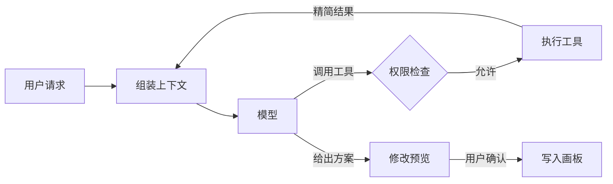

Muse 的 Agent 是画板里的创作搭档：读懂画板上已有的想法，帮用户梳理、延伸，并把结果放回画板。它不替用户做决定，所有修改都先给出预览。

每章先用编号列出「怎么设计」，再按相同编号解释「为什么这样设计」，章末列出参考资料。

## 怎么设计

| 模块 | 职责 | 章节 |
| --- | --- | --- |
| 运行框架 | 驱动循环、记录事件、处理停止与恢复 | Agent 循环 |
| 上下文 | 决定模型每一步看到什么 | 上下文工程 |
| 工具 | 读取和修改画板的唯一通道 | 工具设计 |
| Skill | 按任务加载的工作方法 | Skill 技能 |
| 记忆 | 跨对话保留偏好与决定 | 记忆 |
| 知识库 | 画板之外的参考资料 | 知识库 |
| 权限 | 在模型之外执行的边界 | 权限与安全 |
| 评估 | 判断改动是否让 Agent 更好 | 评估与观测 |

整体遵循五条原则：

1. **单 Agent 为主**：一个主循环完成大部分任务，只在需要隔离上下文时使用子 Agent。
2. **画板是唯一事实来源**：读取以当前画板为准，写入先变成可预览的修改提案。
3. **按需加载**：上下文只放当前需要的信息，Skill、记忆和资料通过工具按需读取。
4. **用户可见、可撤销**：修改、记忆和授权都对用户可见，Agent 的每次写入都能一步撤销。
5. **边界写在代码里**：权限、校验和数据隔离由运行框架执行，不依赖提示词约束模型。

## 为什么这样设计

### 1. 单 Agent 为主

Anthropic 在《Building effective agents》中建议从最简单的方案开始，只在能证明收益时增加复杂度。画板上的任务大多是「读画板 → 想方案 → 改画板」的短链路，前后步骤依赖同一份画板细节，一个循环就能完成。多 Agent 会增加 token 消耗，也更容易出现风格不一致的结果。

### 2. 画板是唯一事实来源

用户和 Agent 同时在一块画板上工作，画板随时可能被用户修改。以最新画板状态为准，Agent 不会基于过期信息操作；写入先成为提案，用户始终掌握画板的最终修改权。

### 3. 按需加载

上下文越长，模型越难注意到关键信息，成本和延迟也越高。把 Skill、记忆和资料放在上下文之外、需要时再读取，可以在能力增加时保持每一步上下文精简。

### 4. 用户可见、可撤销

创作内容属于用户。看得见 Agent 改了什么、记住了什么，用户才会信任它；能撤销，用户才敢让它多做一些。

### 5. 边界写在代码里

提示词只能降低模型越界的概率，不能保证不越界，尤其在资料中混入恶意指令时。由代码执行的权限检查不受模型输出影响，结果确定。

## 当前实现与设计的对应

| 设计 | 当前演示 |
| --- | --- |
| 修改先预览，确认后写入 | 已实现：建议以便签预览展示，点击后加入画板 |
| 用户控制 Agent 能否读取画板 | 已实现：「引用画板」开关 |
| 停止生成并保留输入 | 已实现：停止后问题恢复为草稿 |
| 模型调用与工具循环 | 未实现：浏览器内规则生成示例 |
| Skill、记忆、知识库、细粒度权限、评估 | 设计方案 |

## 参考

- [Building effective agents](https://www.anthropic.com/engineering/building-effective-agents)（Anthropic）
- [Effective context engineering for AI agents](https://www.anthropic.com/engineering/effective-context-engineering-for-ai-agents)（Anthropic）
